# Poke-Farm

Poke-Farm is a fan-made ranch viewer built with Godot. Pokémon from your own game saves wander around a large
ranch with five biomes, a lake, a day and night cycle, meals, naps and group get-togethers, while a camera
follows them around. Regular and shiny colours are both supported. It's made to sit open on a second monitor and
be fun to look at.

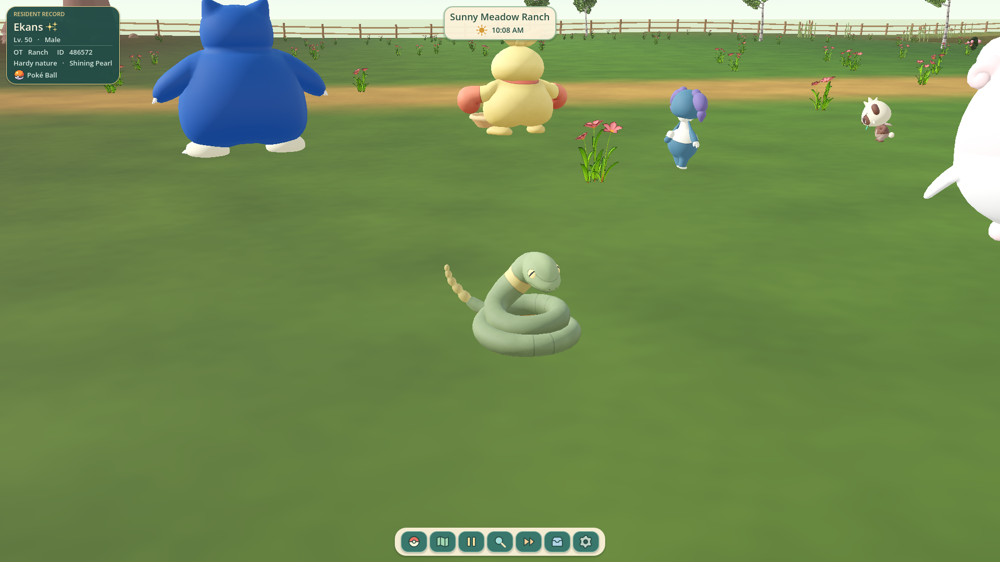

> **Unofficial fan project.** Poke-Farm is free, non-commercial, and not affiliated with, endorsed by or
> sponsored by Nintendo, Game Freak, Creatures Inc. or The Pokémon Company. Pokémon and its names and characters
> belong to their owners. If a rights holder asks me to take this down, I will. It has nothing to do with My
> Pokémon Ranch on the Wii.

## What it does

- **Your Pokémon, copied in.** Deposit Pokémon from a save file (see
  [Importing Pokémon from a save](#importing-pokémon-from-a-save)). Poke-Farm only reads the save and keeps its
  own copies. There's also a built-in showcase ranch if you just want to look around.
- **Regular and shiny** appearances, alternate forms, and each Pokémon at its size relative to the others.
- **A big ranch.** Five biomes (Clover Downs, Fernwood Hollow, Frostpine Ridge, Ember Terraces and Reedwater
  Lake), paths, a fence all the way round, and a lake that water Pokémon use.
- **Residents live their own lives.** They wander, rest and play, and some swim or fly. They sleep at night and
  wake in the morning.
- **Meals.** Breakfast, lunch and dinner each get a banner and bowls of berries, and residents gather round.
- **Group events.** Residents meet, turn toward each other and walk together. There's ball play and a parade for
  groups that can do them.
- **Resident Record.** A card for whoever the camera is on: name or nickname, shiny mark, level, gender, original
  trainer and ID, nature, ball, and the game they came from.
- **An automatic camera.** It tours the ranch, stays with one resident, then moves to the next, and frames each
  one to its size.
- **A map view, a finder, pause, next, zoom, hide-the-interface, deposits and settings.**
- **A moving day and night cycle** with its own music. You can mute the music and Poke-Farm remembers that.
- **Your own ranch name.** You choose it in settings. It isn't fixed.
- **Settings that stick**, including how many residents are in the pasture and how many 3D models are drawn near
  the camera, so you can match it to your PC.

I haven't checked every model, animation, eye, colour palette, form or size by eye. Treat all of those as a work
in progress (see [Known gaps](#known-gaps)).

### Screenshots

| | |
|---|---|
| 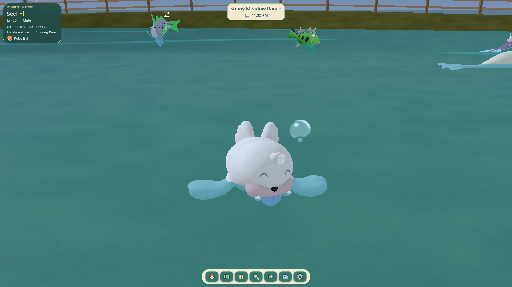 | 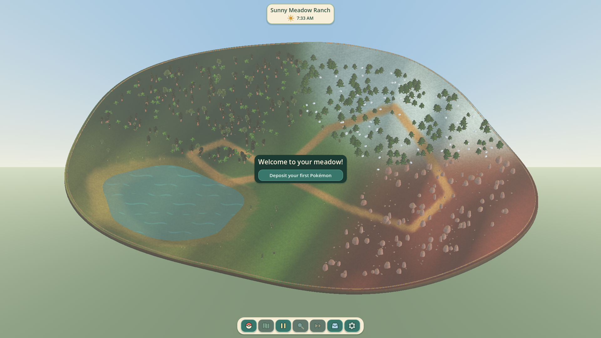 |
| Night. Sleeping residents show a Z. | The map view (**Space**). |
| 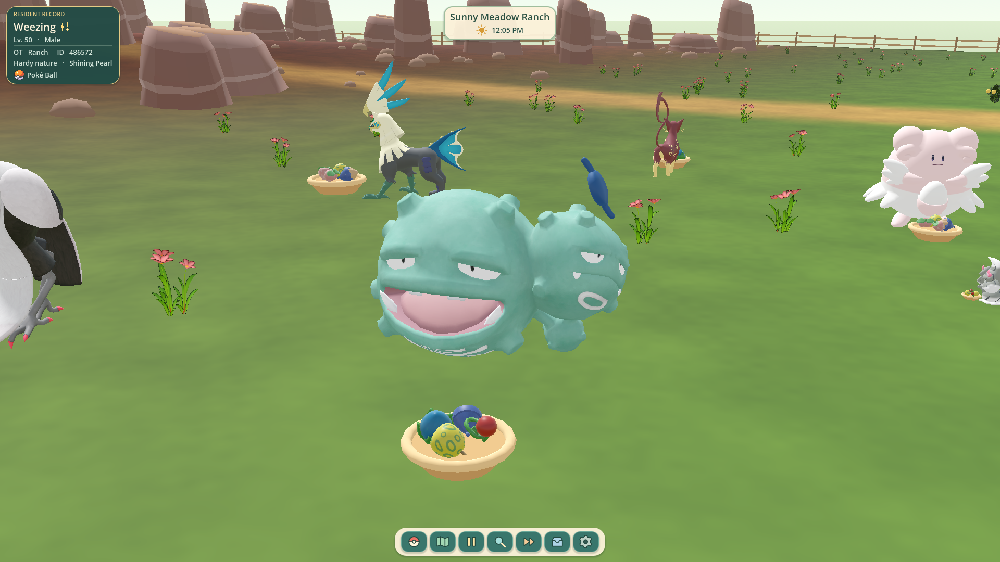 | 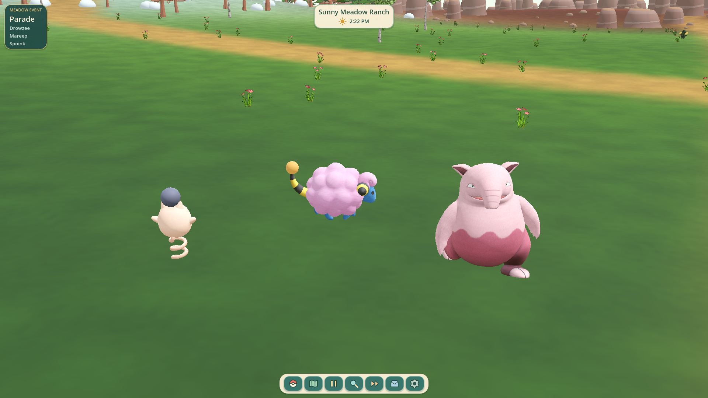 |
| Mealtime. | A group event. |
| 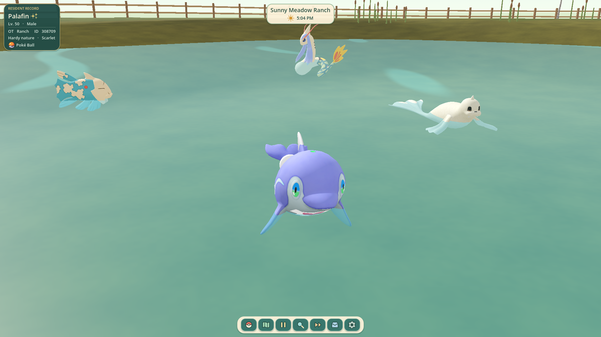 | 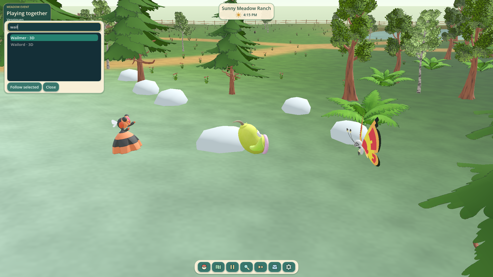 |
| Water residents at Reedwater Lake. | The finder (**D**). |
| 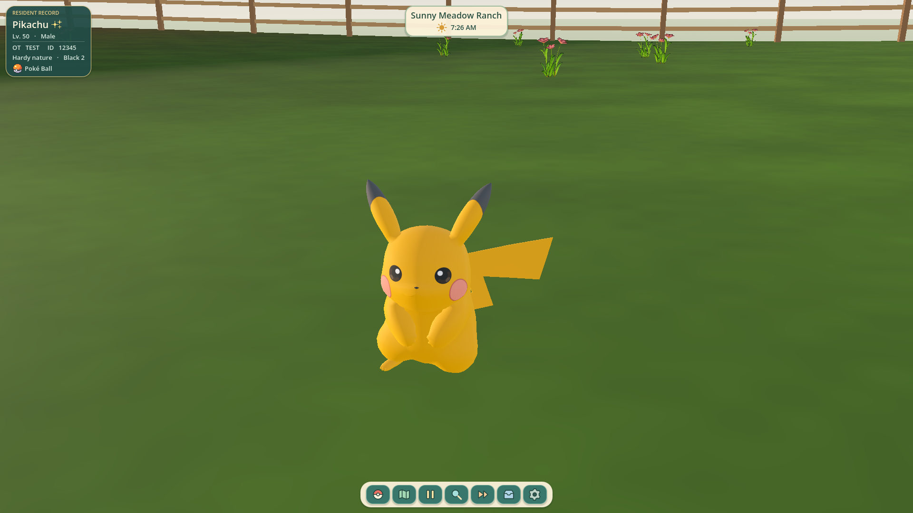 | 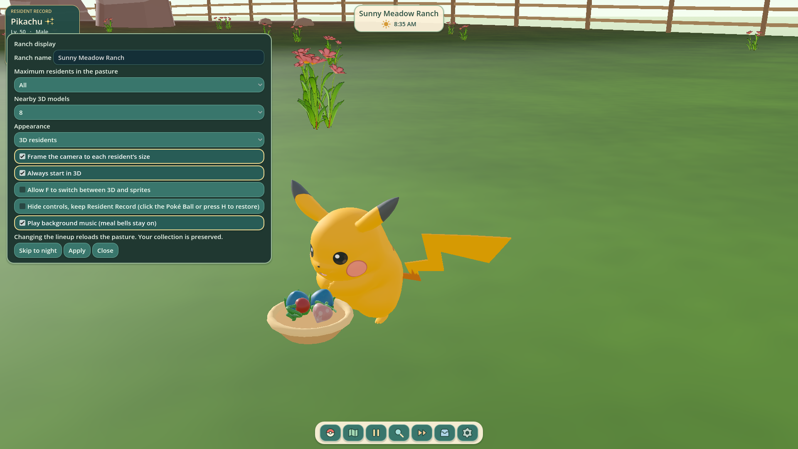 |
| The Resident Record card. | Settings (**S**). |

## Using Poke-Farm

Run `Poke-Farm.exe`. The first time, the ranch is empty and says **Welcome to your meadow!** Click **Deposit your
first Pokémon**, or open the deposit screen and choose the built-in showcase to see the ranch with a ready-made
population.

The camera tours on its own. It stays with one resident for a while, glides to the next, and widens out when a
group event starts. Press **N** to skip ahead, **Space** for the map, or **P** to pause.

### The toolbar

The bar along the bottom has seven buttons, left to right:

| Button | What it does |
|---|---|
| Poké Ball | Hides or shows the interface |
| Map | Switches between following residents and the map view |
| Pause | Pauses or resumes the tour |
| Magnifying glass | Opens the finder |
| Fast-forward | Goes to the next resident |
| Tray | Opens deposits |
| Gear | Opens settings |

### Keyboard

| Key | What it does |
|---|---|
| **Space** | Switch between the map and following residents |
| **N** | Next resident |
| **P** | Pause or resume |
| **D** | Open the resident finder |
| **S** | Open settings |
| **H** | Hide or show the interface |
| **+** / **-** / **0** | Zoom in, zoom out, reset zoom |
| **F** | Switch between 3D and sprites. Only works if you turned it on in settings |
| **Esc** | Close the open panel. With nothing open, **it quits Poke-Farm** |

### Settings

Open settings with **S** or the gear. You can change:

- the ranch name,
- the most residents in the pasture (50 up to All),
- how many 3D models are drawn near the camera (4, 8, 12 or 24),
- the appearance: Mixed, 3D residents or Shiny sprites,
- whether the camera frames each resident to its size,
- whether Poke-Farm always starts in 3D,
- whether **F** can switch between 3D and sprites,
- hiding the controls while keeping the Resident Record,
- background music on or off (meal bells stay on either way).

Your choices are saved and come back the next time you start it. **Skip to night** jumps the clock to the evening.

## Importing Pokémon from a save

Poke-Farm reads a save file **on your own PC** and makes its own copies of the Pokémon in it. It does not move,
delete, trade or change anything in the original save, and nothing is uploaded anywhere. A save is read, and copies
are deposited.

Poke-Farm doesn't need ROMs, game dumps, encryption keys, an emulator or any Nintendo account details. Never put
those on GitHub or anywhere else public.

**Before you start, back up the save.** Copy it somewhere safe. Poke-Farm won't change it, but you should never use
a third-party tool on your only copy.

### Step by step

1. Launch Poke-Farm.
2. Click **Deposit your first Pokémon** on an empty ranch, or the tray button on the toolbar.
3. Choose a save. Either pick one from the **detected save** menu, or click **Choose a save file…** to find one on
   your computer.
4. Wait while Poke-Farm reads it. The line under the save row says how many Pokémon are ready to add.
5. Pick the Pokémon you want. Click each one to select it, or use **Select all shown**. The **Box** menu shows one
   box at a time, and **Shinies only** shows just shinies.
6. Check the **selected** count, then click **Add selected to ranch**.
7. The ranch reloads with your deposited Pokémon.

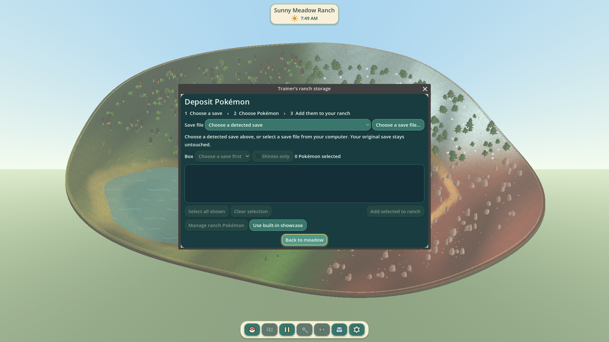

*Step 3: nothing is loaded yet, so the filters are greyed out. The line under the save row says your original
save stays untouched.*

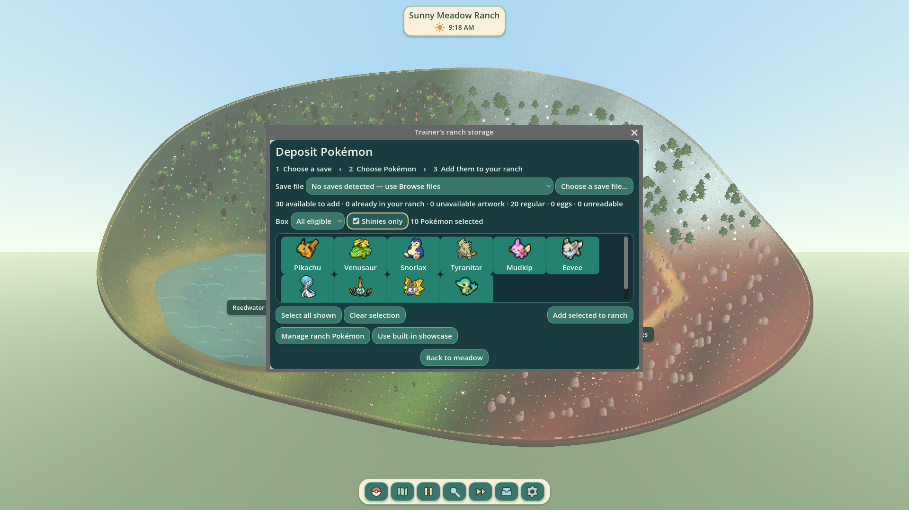

*Steps 4 to 6: a save is loaded. This one is a made-up test save. **Shinies only** is ticked, **Select all
shown** has picked all ten shinies, and the line under the save row shows what was found.*

### Which files work

You can choose any file in the file picker. Common ones are:

- `.sav` for many cartridge backups and emulator saves
- `.dsv` for DeSmuME saves
- `main` for many decrypted Switch saves

The bundled Save Reader decides whether it understands a file. It reads Generation 1 to 9 saves that are intact
and **decrypted**. The detected-save menu only finds Switch saves named `main`, in your Downloads folder, in
`Documents\Poke-Farm\Saves` (plus the legacy `Documents\Shiny Ranch\Saves` folder), and in the usual Ryujinx,
Ryubing and yuzu save folders. For anything else, use
**Choose a save file…**.

### If something goes wrong

- **"Could not read this save."** The save may be encrypted, damaged or from an unsupported game. Use an intact,
  decrypted save.
- **Save states aren't saves.** An emulator save state is not the same as a normal battery or cartridge save.
- **Some Pokémon are skipped.** The line under the save row counts how many were left out because their form or
  artwork isn't available.
- **Eggs and unreadable records** are counted separately and aren't deposited.
- **The Save Reader needs .NET 9.** It's a separate program in the `Save Reader` folder, which has to stay next to
  `Poke-Farm.exe`. It isn't self-contained, so Windows needs the .NET 9 runtime installed.
- **Pokémon you've already deposited** show as "already in your ranch" and aren't added twice.

### Managing the ranch

Click **Manage ranch Pokémon** on the deposit screen to see everything you've deposited.

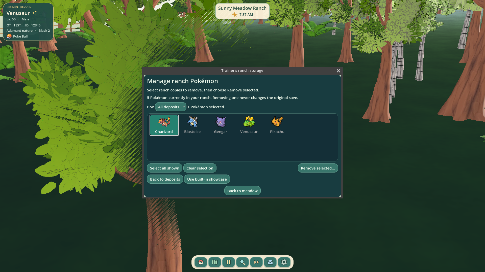

- Select one, several, or **Select all shown**, then **Remove selected…** and confirm. This removes only the ranch
  copies. **It never changes your original save**, and you can deposit them again later.
- **Back to deposits** returns to the save screen.
- **Use built-in showcase** switches to the included showcase ranch for a while. The button then becomes **Use my
  deposited Pokémon**, which switches back.
- An empty ranch is fine. It stays empty until you deposit something.

Your deposits and settings live on your PC in `%APPDATA%\Godot\app_userdata\Poke-Farm\`. Deleting that folder
resets them.

If you previously used a build named **Shiny Ranch**, Poke-Farm automatically copies the old `deposits.cfg`
into its new data folder the first time it starts. The original file is left untouched.

## What's included and what isn't

This repo has the Godot project: scripts, scenes, shaders, the ranch layout and behaviour data, and the tools to
fetch the models. It does not hold the built game (the full data pack is too big for a normal GitHub file), the
original game files, anyone's saves, or the compiled Save Reader program.

The Save Reader is a small separate helper that reads saves. Its source is in
[`tools/save-reader`](tools/save-reader/README.md). It uses PKHeX.Core, which is GPL-3.0 licensed. See
[`THIRD-PARTY-ASSETS.md`](THIRD-PARTY-ASSETS.md) for the notice and source link.

### Getting the models and visual assets

The Pokémon models are three zip files on the [models-1 release](../../releases/tag/models-1), about 3.5 GB in
total. A fourth archive contains the visual runtime companions: regular palettes, deposit thumbnails, eye and
effect textures, and meal props. After cloning, run this from the repo folder in PowerShell:

```powershell
powershell -ExecutionPolicy Bypass -File tools\fetch_models.ps1
```

It downloads all four zips, checks each one against the SHA-256 in `tools/models-manifest.json`, and unpacks the
models into `models/` and their visual companions into `map/`. You can delete `models-download/` afterwards.

There are 1,453 `.glb` files, one per species, form and variant. They were converted from the games' own 3D files
with a converter I wrote for a separate project, and they come from my model library (`pokemon-model-library`),
where fixes are made first. **They are not mine and they are not licensed.** I'm sharing them as a fan, knowing The
Pokémon Company could object, and I'll remove them if asked. Other fan projects hosting similar files don't make
that okay, and I'm not claiming they do.

### Running from source

You need Windows 10 or 11 and Godot 4.7 or newer (the project targets 4.7.2). Clone the repo, fetch the models
(above), and run the full ranch from a terminal in the repo folder:

```powershell
godot --path . -- --full
```

(Use the path to your Godot executable.) The source-asset download supplies the models, thumbnails, palette and
effect textures, and berry models. Music is intentionally available only in packaged game builds; a source clone
runs silently without logging missing-audio errors.

Depositing from a save needs the Save Reader. Build it from `tools/save-reader` with .NET 9 (the steps are in that
folder's README). In a packaged build it goes in a `Save Reader` folder next to `Poke-Farm.exe`. The checked-in
source has been built successfully with .NET 9 and tested against a synthetic Generation 5 save.

## Known gaps

- The model catalog isn't fully checked. Some colours, eyes, animations and sizes are probably wrong.
- Only Windows has been tested.

## Credits and licence

The code in this project is open source under the [MIT licence](LICENSE): the scripts, scenes, shaders, tools and
original data files. Use it, change it and share it. The MIT licence covers **only** my own work. It gives you no
rights to Pokémon or anything from the games, the model files, the music, or other people's assets, which are
covered by their own terms below.

The separate helper in `tools/save-reader` is licensed under **GPL-3.0-only** because it links to GPL-3.0
PKHeX.Core. Its source, build notes and complete licence text are included in that folder. This licence applies
to the Save Reader helper, not the separately packaged Godot application.

- **Stylized Nature MegaKit** by Quaternius (CC0): the meadow's trees, shrubs, grasses and rocks.
- **PKHeX.Core** by Kurt (kwsch), GPL-3.0: used by the Save Reader to read save files. The licence text is in
  `tools/save-reader/LICENSE-PKHEX.txt`.
- **Free Fantasy Music Pack** by Donát Baracsi: the day and night soundtrack. The creator asks for credit. The
  music files aren't in this repo or the source-asset download. They are bundled only with packaged game builds;
  source clones run silently when the files are absent.

Sources, terms and details are in [THIRD-PARTY-ASSETS.md](THIRD-PARTY-ASSETS.md). `PUBLIC-CATALOG-NOTES.md` says
what was left out of the published JSON catalogs.
